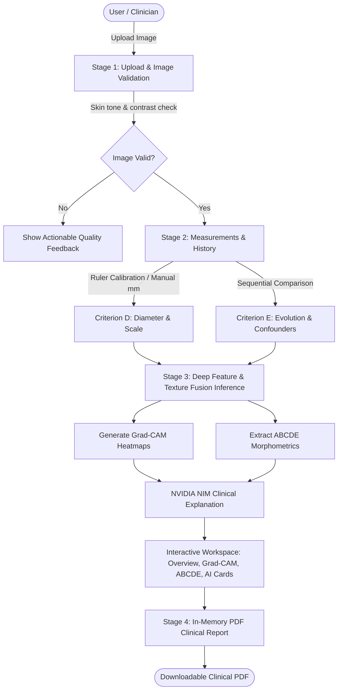

# DermaAssist — AI-Assisted Skin Lesion Screening & Clinical Decision Support

[](https://skin-cancer-app-three.vercel.app)
[](https://skin-cancer-app-41kd.onrender.com)
[](https://skin-cancer-app-41kd.onrender.com/docs)
[](https://python.org)
[-EE4C2C?style=flat-square&logo=pytorch&logoColor=white)](https://pytorch.org)
[-61DAFB?style=flat-square&logo=react&logoColor=black)](https://react.dev)
[](https://tailwindcss.com)
[](LICENSE)

DermaAssist is a full-stack **Clinical Decision Support System (CDSS)** for preliminary skin lesion screening and risk stratification. The platform integrates deep convolutional feature representations (**ResNet-18**) with handcrafted texture descriptors (**GLCM + 2D Haar Wavelet**), explainable AI (**Grad-CAM** saliency maps), quantitative dermatological **ABCDE criteria** (with interactive ruler calibration and longitudinal image alignment), structured **NVIDIA NIM** clinical decision reasoning, and dynamic **PDF screening report generation**.

---

## 🌐 Live Deployments & Verified Links

| Service | Environment | URL | Status |
| :--- | :--- | :--- | :--- |
| **Frontend Application** | Production (Vercel) | [https://skin-cancer-app-three.vercel.app](https://skin-cancer-app-three.vercel.app) | 🟢 Live |
| **Backend API Service** | Production (Render Docker) | [https://skin-cancer-app-41kd.onrender.com](https://skin-cancer-app-41kd.onrender.com) | 🟢 Live |
| **Interactive API Documentation** | Swagger / OpenAPI | [https://skin-cancer-app-41kd.onrender.com/docs](https://skin-cancer-app-41kd.onrender.com/docs) | 🟢 Active |
| **Source Code Repository** | GitHub | [https://github.com/Manikantareddie/Skin_cancer_app](https://github.com/Manikantareddie/Skin_cancer_app) | 🟢 Active |

---

## 📌 Project Overview

Early detection of malignant melanoma significantly improves clinical outcomes and patient survival rates. However, access to board-certified dermatologists is often constrained by geographical, financial, and triage bottlenecks.

**DermaAssist** was built as an assistive, decision-support screening tool designed to bridge the gap between initial patient concern and professional clinical evaluation:
- **Assistive, Non-Autonomous:** Designed to support clinicians, triage practitioners, and patients by highlighting morphological risks, not to serve as an autonomous black-box diagnosis.
- **Multimodal Visual Evidence:** Merges global deep visual features with localized micro-texture frequency analysis.
- **Transparent AI (XAI):** Pairs every prediction with Grad-CAM visual heatmaps, mathematical ABCDE morphometrics, physical scale measurement, and longitudinal evolution tracking.
- **Strict Clinical Safety Gates:** Rejects invalid photos (such as non-skin objects, text documents, or blurry captures) prior to running deep inference.

---

## ✨ Key Features

### 1. Dual-Branch PyTorch Deep Learning Classifier
- **Backbone:** ResNet-18 deep convolutional neural network extracts 512 high-level semantic representations.
- **Texture Engine:** Handcrafted Gray-Level Co-occurrence Matrix (GLCM) and 2D Discrete Haar Wavelet Transform (DWT) extract 12 micro-structural skin texture features.
- **Feature Fusion:** Dense projection and fusion layer ($512 + 64 = 576$ dimensions) with dropout regularization ($p=0.3$) outputs calibrated logits for binary classification (`Benign` vs. `Malignant`).

### 2. Explainable AI via Grad-CAM Heatmaps
- Class Activation Mapping (Grad-CAM) computed on the final convolutional layer (`layer4[-1]`).
- Visualized using an interactive OpenCV Jet colormap overlay.
- Frontend includes side-by-side mode, an interactive opacity slider ($0\%-100\%$), and high-resolution lightbox inspection.

### 3. Quantitative ABCDE Dermatological Criteria
- **A — Asymmetry:** Horizontal and vertical contour asymmetry index computed via binary Otsu mask folding.
- **B — Border Irregularity:** Normalized isoperimetric quotient (compactness) measuring contour border waviness.
- **C — Color Variegation:** K-means clustering ($k=4$) in CIELAB/RGB color space identifying dominant pigment variations (Light/Dark Brown, Black, Red, White, Blue-Gray).
- **D — Diameter & Calibrated Physical Scale:**
  - Interactive two-point touchscreen/mouse canvas ruler calibration.
  - Automated ruler tick detection heuristic for guided calibration.
  - Longest **Feret caliper diameter** computed directly from the validated lesion segmentation mask and physical scale.
  - Manual millimeter input support for patient- or clinician-measured values.
  - Strict provenance attribution: `MEASURED`, `USER_REPORTED`, or `UNAVAILABLE`.
  - Objective context against the classic 6 mm clinical guideline (not treated as an absolute diagnostic cutoff).
- **E — Longitudinal Evolution & Temporal History:**
  - Dual-image sequential upload (earlier baseline photograph vs. current follow-up photograph).
  - Explicit baseline and recent date capture tracking.
  - Documented patient-reported symptoms (itching, pain, spontaneous bleeding, rapid enlargement).
  - Feature-based image alignment using ORB keypoints and RANSAC homography.
  - Detection and disclosure of technical confounders (lighting variations, camera angle shifts, magnification differences).
  - Pixel-difference overlay map highlighting stable lesion core, expansion zones, and regression boundaries.
  - Provenance attribution: `OBSERVED`, `REPORTED`, `UNCERTAIN`, or `NOT_ASSESSABLE`.

### 4. NVIDIA NIM Structured Clinical Summary
- Connects to NVIDIA NIM LLM endpoints (`meta/llama-3.1-70b-instruct`) for structured clinical communication.
- Displays four distinct, non-overlapping analytical cards:
  1. *Understanding the Result* (plain-language explanation of classification)
  2. *What the Model Observed* (breakdown of visual findings, texture, and ABCDE factors)
  3. *Important Limitations* (technical boundaries, imaging artifacts, missing history)
  4. *Suggested Next Steps* (guidance on dermatologist consultation, biopsy, and warning signs)
- Built-in deterministic clinical rules fallback engine to guarantee immediate analysis even during API timeouts or rate limits.

### 5. Automated PDF Clinical Screening Report
- In-memory generation using ReportLab without writing sensitive medical data to disk.
- Includes patient metadata, case identifier, high-resolution original photograph, Grad-CAM activation heatmap, longitudinal difference overlay, tabular ABCDE metrics with provenance, and legal disclaimers.

### 6. Mobile-First Fully Responsive Design
- Optimized for all viewport sizes: Small Mobile (320px–375px), Large Mobile (390px–430px), Tablet (768px), Laptop (1024px), Desktop (1440px), and 4K Ultra-Wide (1920px+).
- Touchscreen-friendly interactive calibration canvas (`touch-none` event binding).
- Horizontal scroll protections ensuring zero content clipping or layout breaking across all screen resolutions.

---

## 🔬 Model Architecture & Evaluation

### Neural Network Pipeline

```
Input Image (224 x 224 x 3)
      │
      ├───────────────────────────────────────────┐
      ▼                                           ▼
[Deep CNN Branch]                       [Texture Feature Branch]
ResNet-18 (Pretrained Weights)          GLCM (4) + Haar Wavelet DWT (8)
Global Average Pooling                  Feature Vector (12-dim)
Dense Embedding (512-dim)               Linear Projection (64-dim)
      │                                           │
      └─────────────────────┬─────────────────────┘
                            ▼
                [Fusion Concatenation (576-dim)]
                            │
                     Linear(576, 256)
                            │
                       ReLU + Dropout(0.3)
                            │
                      Linear(256, 2)
                            ▼
              Logits: [Benign, Malignant]
```

### Held-Out Test Evaluation Metrics

The model was evaluated on an independent, held-out validation dataset of dermoscopic and clinical skin lesion images:

| Metric | Score | Clinical Context |
| :--- | :--- | :--- |
| **Accuracy** | **84.23%** | Overall correct classification rate across balanced validation splits |
| **Sensitivity / Recall** | **80.89%** | Identifies >80% of malignant lesions, prioritizing low false-negative rates |
| **Precision** | **56.70%** | Reflects deliberate conservative thresholding to capture suspicious lesions |
| **F1-Score** | **66.67%** | Harmonic balance between sensitivity and precision |
| **Specificity** | **85.04%** | Correctly filters benign nevi, avoiding unnecessary panic |

#### Confusion Matrix (Held-Out Test Set)

$$\begin{pmatrix} \text{True Benign (TN): } 1029 & \text{False Malignant (FP): } 181 \\ \text{False Benign (FN): } 56 & \text{True Malignant (TP): } 237 \end{pmatrix}$$

*Note: In skin cancer screening, high sensitivity (recall) is prioritized to minimize false negatives (missed malignancies).*

- **Checkpoint Distribution:** Weights are published and auto-downloaded on cold boot from Hugging Face Hub: [`reddysorgs/skin-cancer-cdss-model/final_resnet_texture_model.pth`](https://huggingface.co/reddysorgs/skin-cancer-cdss-model).

---

## 🛠️ Technology Stack

| Category | Technologies |
| :--- | :--- |
| **Frontend** | React 18, TypeScript 5, Vite, Tailwind CSS v4, Lucide React, HTML5 Canvas |
| **Backend API** | FastAPI, Uvicorn, Pydantic v2, Python-Multipart, HTTPX |
| **Machine Learning & CV** | PyTorch (CPU-optimized), Torchvision, OpenCV (`opencv-python-headless`), NumPy, SciPy, Scikit-Image, Pillow |
| **Reasoning & Reporting** | NVIDIA NIM API (`meta/llama-3.1-70b-instruct`), ReportLab (In-memory PDF engine) |
| **Deployment & Cloud** | Docker, Render (Containerized Web Service), Vercel (Edge SPA Hosting), Hugging Face Hub |

---

## 🔄 Application Workflow



---

## 📁 Project Structure

```text
Skin_cancer_app/
├── backend/                             # FastAPI application & ML pipeline
│   ├── app/
│   │   ├── api/v1/                      # REST endpoints (/health, /model, /analyze, /measurements, /evolution, /ai, /report)
│   │   ├── core/                        # Application configuration, Pydantic settings & CORS setup
│   │   ├── ml/                          # Core ML: Model architecture, Grad-CAM, GLCM/DWT, Diameter & Evolution engines
│   │   ├── schemas/                     # Strict Pydantic v2 validation contracts
│   │   ├── services/                    # Business logic: Inference, AI explanation, PDF generation
│   │   └── main.py                      # FastAPI entrypoint with exception handlers and middleware
│   ├── scripts/
│   │   ├── test_diameter_evolution.py   # Comprehensive verification suite for Criteria D & E
│   │   ├── test_deployment_readiness.py # Production deployment readiness verification suite
│   │   ├── verify_inprocess.py          # End-to-end integration test
│   │   └── smoke_test.py                # Direct REST API probe
│   ├── Dockerfile                       # Multi-stage production container definition
│   ├── requirements.txt                 # Pinned backend dependencies
│   ├── requirements-dev.txt             # Development and testing dependencies
│   └── .env.example                     # Backend environment variables template
│
├── frontend/                            # React + Vite + TypeScript web interface
│   ├── src/
│   │   ├── api/                         # Typed API client and response interfaces
│   │   ├── components/                  # Responsive components (Navbar, Uploader, Workspace, GradCAM, ABCDE, AI, Report)
│   │   ├── App.tsx                      # 4-stage progressive clinical workflow controller
│   │   ├── index.css                    # Tailwind CSS v4 directives and typography
│   │   └── main.tsx                     # React application entrypoint
│   ├── public/                          # Static assets and icons
│   ├── package.json                     # Frontend dependencies and build scripts
│   ├── tsconfig.json                    # TypeScript compiler configuration
│   └── vite.config.ts                   # Vite build and development proxy configuration
│
├── data/
│   ├── models/                          # Local PyTorch weights cache directory (auto-cached from Hugging Face)
│   ├── samples/                         # Non-sensitive synthetic sample images for unit testing
│   └── README.md                        # Model checkpoint documentation
│
├── .gitignore                           # Git ignore rules (weights, temporary files, environment secrets)
├── LICENSE                              # MIT License
└── README.md                            # Comprehensive project documentation
```

---

## 🚀 Local Installation & Development

### Prerequisites
- **Python:** 3.10, 3.11, or 3.12 (tested on 3.10+)
- **Node.js:** v18.0.0 or higher (tested on v20+)
- **npm:** v9.0.0 or higher
- **Git**

---

### Step 1: Clone the Repository

```bash
git clone https://github.com/Manikantareddie/Skin_cancer_app.git
cd Skin_cancer_app
```

---

### Step 2: Backend Setup (FastAPI)

1. Create and activate a Python virtual environment:
   ```bash
   # Windows (PowerShell)
   python -m venv backend/.venv
   .\backend\.venv\Scripts\Activate.ps1

   # Linux / macOS
   python3 -m venv backend/.venv
   source backend/.venv/bin/activate
   ```

2. Install dependencies:
   ```bash
   pip install --upgrade pip
   pip install -r backend/requirements.txt
   ```

3. Configure environment variables:
   ```bash
   # Windows (PowerShell)
   Copy-Item backend/.env.example backend/.env

   # Linux / macOS
   cp backend/.env.example backend/.env
   ```

4. Start the development server:
   ```bash
   uvicorn backend.app.main:app --host 127.0.0.1 --port 8000 --reload
   ```

5. Verify backend health:
   - Interactive Swagger Docs: [http://127.0.0.1:8000/docs](http://127.0.0.1:8000/docs)
   - Healthcheck: [http://127.0.0.1:8000/api/v1/health](http://127.0.0.1:8000/api/v1/health)

---

### Step 3: Frontend Setup (React + Vite)

1. Open a new terminal and navigate to `frontend/`:
   ```bash
   cd frontend
   ```

2. Install dependencies:
   ```bash
   npm install
   ```

3. Start the Vite development server:
   ```bash
   npm run dev
   ```

4. Open the application in your browser:
   - Web App: [http://localhost:5173](http://localhost:5173)

---

## ⚙️ Environment Configuration

### Backend (`backend/.env`)

| Variable | Default Value | Description |
| :--- | :--- | :--- |
| `BACKEND_PORT` | `8000` | Port for the Uvicorn server to bind to |
| `CORS_ORIGINS` | `["http://localhost:5173", "https://skin-cancer-app-three.vercel.app"]` | Allowed CORS origins for browser fetch requests |
| `NVIDIA_API_KEY` | *(Optional)* | NVIDIA NIM API key for LLM decision explanations |
| `NVIDIA_BASE_URL` | `https://integrate.api.nvidia.com/v1` | NVIDIA API endpoint URL |
| `NVIDIA_MODEL` | `meta/llama-3.1-70b-instruct` | NVIDIA model tag for clinical explanations |
| `MODEL_CACHE_DIR` | `data/models` | Local directory for storing downloaded weights |
| `HF_MODEL_REPO_ID` | `reddysorgs/skin-cancer-cdss-model` | Hugging Face Hub repository identifier |
| `HF_MODEL_FILENAME`| `final_resnet_texture_model.pth` | Checkpoint filename on Hugging Face |

*Note: If `NVIDIA_API_KEY` is omitted, the backend automatically uses its built-in deterministic clinical rules engine without crashing.*

### Frontend (`frontend/.env` / Vercel Environment Variables)

| Variable | Example Value | Description |
| :--- | :--- | :--- |
| `VITE_API_URL` | `https://skin-cancer-app-41kd.onrender.com` | Base URL pointing to the live or local FastAPI backend |

---

## 🚢 Production Deployment

### Backend on Render (Docker Web Service)
- **Environment:** Docker
- **Docker Context:** Repository Root (`.`)
- **Dockerfile Path:** `backend/Dockerfile`
- **CPU PyTorch:** Built using `torch==2.2.2+cpu` and `torchvision==0.17.2+cpu` to maintain a compact, fast container.
- **Port:** Dynamically binds to Render's `$PORT` environment variable via `0.0.0.0`.
- **Worker Configuration:** Single Uvicorn worker to optimize memory consumption under container memory limits.

### Frontend on Vercel
- **Framework Preset:** Vite
- **Root Directory:** `frontend`
- **Build Command:** `npm run build`
- **Output Directory:** `dist`
- **Environment Variable:** Set `VITE_API_URL=https://skin-cancer-app-41kd.onrender.com`.

---

## 🧪 Testing & Verification

Execute the automated test suites:

```bash
# Run Criterion D (Diameter) & Criterion E (Evolution) validation suite
python backend/scripts/test_diameter_evolution.py

# Run Production Deployment Readiness suite
python backend/scripts/test_deployment_readiness.py

# Build frontend to verify TypeScript types and Tailwind CSS
npm --prefix frontend run build
```

---

## ⚠️ Clinical Limitations & Medical Disclaimer

> ### **CRITICAL MEDICAL & REGULATORY NOTICE**
> 
> **DermaAssist is an investigational screening prototype and Clinical Decision Support System (CDSS) created strictly for educational, research, and preliminary screening support.**
> 
> - **Not a Diagnostic Device:** This application is **not** cleared, certified, or approved by the U.S. Food and Drug Administration (FDA), European Medicines Agency (CE-IVD), or any other regulatory authority.
> - **Biopsy Requirement:** Histopathological examination of a tissue biopsy performed by a board-certified dermatopathologist remains the definitive diagnostic standard for cutaneous malignancy.
> - **Potential for Errors:** False positives and false negatives may occur due to non-standard illumination, camera angle, patient motion, atypical lesion biology, or skin pigmentation variations.
> - **Never Delay Care:** Users should **never** delay, disregard, or modify professional medical consultation or treatment based on outputs generated by this software. Always consult a qualified dermatologist or physician for evaluation of any new, changing, symptomatic, or concerning skin lesion.

---

## 🔮 Future Improvements & Roadmap

- [ ] **Multi-Class Classification:** Expand model capabilities beyond binary classification to categorize lesions across 8 distinct ISIC diagnostic classes (Melanoma, Melanocytic Nevus, Basal Cell Carcinoma, Actinic Keratosis, Benign Keratosis, Dermatofibroma, Vascular Lesion, Squamous Cell Carcinoma).
- [ ] **Clinical Trial Validation:** Conduct prospective multi-center clinical validation across diverse Fitzpatrick phototypes (I through VI).
- [ ] **Smartphone Optical Calibration:** Implement automated ArUco marker and color calibration card detection for variable smartphone camera sensors.
- [ ] **Interoperability (FHIR / DICOM):** Implement HL7 FHIR skin lesion screening resources and standard DICOM-compliant image exchange for seamless electronic health record (EHR) integration.

---

## 📄 License

This project is licensed under the MIT License — see the [LICENSE](LICENSE) file for details.
