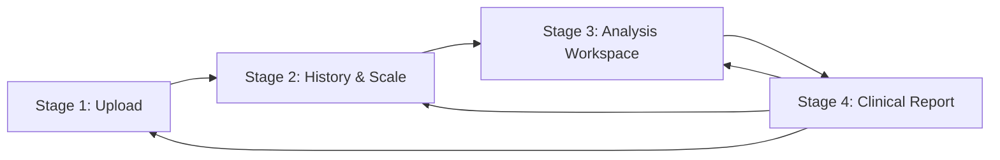

# DermaAssist — AI Skin Lesion Screening & Clinical Decision Support System (CDSS)

DermaAssist is a modern full-stack Clinical Decision Support System (CDSS) for skin lesion screening. The platform combines deep convolutional feature extraction (ResNet-18) with handcrafted texture representations (GLCM + Haar Wavelet), explainable AI (Grad-CAM), scientifically verified ABCDE dermatological criteria with interactive scale calibration and longitudinal image registration, structured NVIDIA NIM clinical explanations, and PDF clinical report generation.

---

## 1. System Architecture

```text
Skin_cancer_app/
├── backend/                             # FastAPI application & ML pipeline
│   ├── app/
│   │   ├── api/v1/                      # Endpoints (/health, /model, /analyze, /measurements, /evolution, /ai, /report)
│   │   ├── core/                        # Configuration & settings (Pydantic BaseSettings)
│   │   ├── ml/                          # PyTorch model, Grad-CAM, GLCM/DWT, Diameter & Evolution engines
│   │   ├── schemas/                     # Pydantic v2 data contracts & schemas
│   │   ├── services/                    # Clinical, model, AI, and report generation services
│   │   └── main.py                      # FastAPI application entrypoint with CORS
│   ├── scripts/
│   │   ├── test_diameter_evolution.py   # Comprehensive D & E test suite (ruler, registration, confounders)
│   │   ├── verify_inprocess.py          # End-to-end in-process integration test
│   │   └── smoke_test.py                # Direct API verification script
│   ├── requirements.txt                 # Backend dependencies
│   ├── requirements-dev.txt             # Development & testing dependencies
│   └── .env.example                     # Environment variables template
│
├── frontend/                            # React + Vite + TypeScript web interface
│   ├── src/
│   │   ├── api/                         # Typed API client & response interfaces
│   │   ├── components/                  # UI components (Uploader, Measurements, Grad-CAM, ABCDE, AI Summary, Report)
│   │   ├── App.tsx                      # 4-stage workflow application shell
│   │   └── main.tsx                     # React entrypoint
│   ├── package.json                     # Vite, Tailwind CSS v4, Lucide Icons
│   └── vite.config.ts                   # Proxy configuration for backend /api
│
├── data/
│   ├── models/                          # Local PyTorch weights cache (.pth) (auto-downloaded from HF Hub)
│   ├── samples/                         # Non-sensitive synthetic sample images for testing
│   └── README.md                        # Checkpoint documentation
│
└── legacy/
    └── app.py                           # Original Streamlit implementation (preserved for reference)
```

---

## 2. Four-Stage Progressive Clinical Workflow

DermaAssist guides users and clinicians through a structured 4-stage screening pipeline:



1. **Stage 1 — Upload:**
   - Drag-and-drop uploader supporting JPG, JPEG, and PNG.
   - Pre-inference validation gate verifying skin context, contrast, face exclusion, and document rejection.
   - Immediate image preview with option to change or remove file.

2. **Stage 2 — Measurements & History (Dedicated Step):**
   - **Criterion D (Diameter & Physical Scale):**
     - Interactive two-point ruler calibration on image canvas.
     - Automated periodic tick detection heuristic.
     - Longest Feret caliper diameter calculated from verified segmentation contour.
     - Manual millimeter entry (Patient/Clinician Reported).
     - Strict provenance classification: `MEASURED`, `USER_REPORTED`, or `UNAVAILABLE`.
     - *No arbitrary pixel-to-millimeter conversions.*
     - Explicit guidance on the 6 mm heuristic reference.
   - **Criterion E (Longitudinal Evolution & History):**
     - Upload an earlier photograph of the same lesion.
     - Specify baseline and recent capture dates.
     - Document patient-reported changes (size, shape, color, itching, pain, bleeding, crusting).
     - Automated feature-based image alignment using tuned ORB + RANSAC Homography.
     - Detection and disclosure of technical confounders (camera angle, lighting shift, magnification, blur).
     - Visual difference overlay map (Green: Stable core; Red: Expansion; Blue: Baseline outline).
     - Provenance classification: `OBSERVED`, `REPORTED`, `UNCERTAIN`, or `NOT_ASSESSABLE`.

3. **Stage 3 — Analysis Workspace:**
   - **Screening Overview:** Classification category (e.g., *"Model classified into benign category"*), qualified score (*"Uncalibrated neural network output score (84.23% test accuracy, 80.89% recall)"*), and recommendation for professional evaluation.
   - **Visual Analysis (Grad-CAM):** Side-by-side mode, interactive blended overlay with opacity slider (0–100%), and high-resolution inspection modal.
   - **Morphological Characteristics (ABCDE):** Contour asymmetry index, border compactness score, K-Means color clustering, calibrated Feret diameter with provenance, and longitudinal evolution summary.
   - **AI Explanation (NVIDIA NIM):** Structured 4-card grid:
     1. *Understanding the Result*
     2. *What the Model Observed*
     3. *Important Limitations*
     4. *Suggested Next Steps*
     (With automatic deterministic clinical rules fallback).

4. **Stage 4 — Report Preview & Export:**
   - Full clinical screening document layout formatted for printing and digital review.
   - Side-by-side original image, Grad-CAM activation heatmap, and longitudinal difference overlay.
   - Tabular ABCDE criteria with measurement provenance.
   - Downloadable PDF report dynamically generated and streamed using ReportLab.

---

## 3. Machine Learning Architecture (Preserved Core)

- **Deep Feature Extractor:** PyTorch ResNet-18 backbone with final fully connected layer replaced with `nn.Identity()`, producing a 512-dimensional visual embedding.
- **Handcrafted Texture Branch:**
  - 4 Gray-Level Co-occurrence Matrix (GLCM) features: contrast, homogeneity, energy, correlation.
  - 8 2D Haar Discrete Wavelet Transform (DWT) features: means and standard deviations of approximation ($cA$) and detail ($cH, cV, cD$) sub-bands.
  - Projected via `Linear(12, 64)`.
- **Fusion Head:** Concatenated $512 + 64 = 576$ features passed through `Linear(576, 256) -> ReLU -> Dropout(0.3) -> Linear(256, 2)`.
- **Model Checkpoint:** Auto-downloaded from Hugging Face Hub (`reddysorgs/skin-cancer-cdss-model/final_resnet_texture_model.pth`) and cached locally in `data/models/`.
- **Explainability:** Grad-CAM attached to `model.backbone.layer4[-1]` with OpenCV Jet colormap overlay.

---

## 4. Quick Start & Local Setup

### Prerequisites
- Python 3.10+ (tested with Python 3.14)
- Node.js 18+ (tested with Node.js v24.15.0)

### 1. Backend Setup (FastAPI)
```powershell
# Navigate to project root
cd Skin_cancer_app

# Create and activate virtual environment
python -m venv backend/.venv
.\backend\.venv\Scripts\activate   # Windows
# source backend/.venv/bin/activate # Linux/macOS

# Install dependencies
pip install -r backend/requirements.txt

# Configure environment variables
copy backend\.env.example backend\.env

# Start the FastAPI server
uvicorn backend.app.main:app --host 127.0.0.1 --port 8000 --reload
```

FastAPI documentation will be available at:
- Swagger UI: `http://127.0.0.1:8000/docs`
- ReDoc: `http://127.0.0.1:8000/redoc`

### 2. Frontend Setup (React + Vite)
```powershell
# Navigate to frontend directory
cd frontend

# Install packages
npm install

# Start development server
npm run dev
```

Open `http://localhost:5173` in your browser.

---

## 5. API Endpoints

| Method | Endpoint | Description |
| :--- | :--- | :--- |
| `GET` | `/api/v1/health` | Service health status and timestamp |
| `GET` | `/api/v1/model/status` | Model loading state, device, and architecture info |
| `POST` | `/api/v1/analyze` | Full screening pipeline (Upload, Validation, D, E, ResNet18, Grad-CAM) |
| `POST` | `/api/v1/measurements/calibrate-ruler` | Two-point ruler calibration and Feret diameter calculation |
| `POST` | `/api/v1/evolution/compare` | Image registration, comparability grading, and difference overlay |
| `POST` | `/api/v1/ai/summary` | NVIDIA NIM structured clinical explanation (or rule fallback) |
| `POST` | `/api/v1/report/generate` | In-memory ReportLab PDF clinical report streaming |

---

## 6. Testing & Verification

Run the verification test suite:

```powershell
# Comprehensive D & E Test Suite (Ruler, Manual, Alignment, Confounders, Missing History)
.\backend\.venv\Scripts\python.exe backend\scripts\test_diameter_evolution.py

# Full In-Process Stack Regression Test
.\backend\.venv\Scripts\python.exe backend\scripts\verify_inprocess.py

# Frontend TypeScript & Vite Production Build
npm --prefix frontend run build
```

---

## 7. Clinical Disclaimer

> **Educational & Decision-Support Notice:**
> DermaAssist is an experimental clinical decision support research tool. It does **not** provide a definitive medical diagnosis and cannot replace in-person dermatoscopic examination, dermato-pathology evaluation, or histological biopsy by a qualified medical professional.
